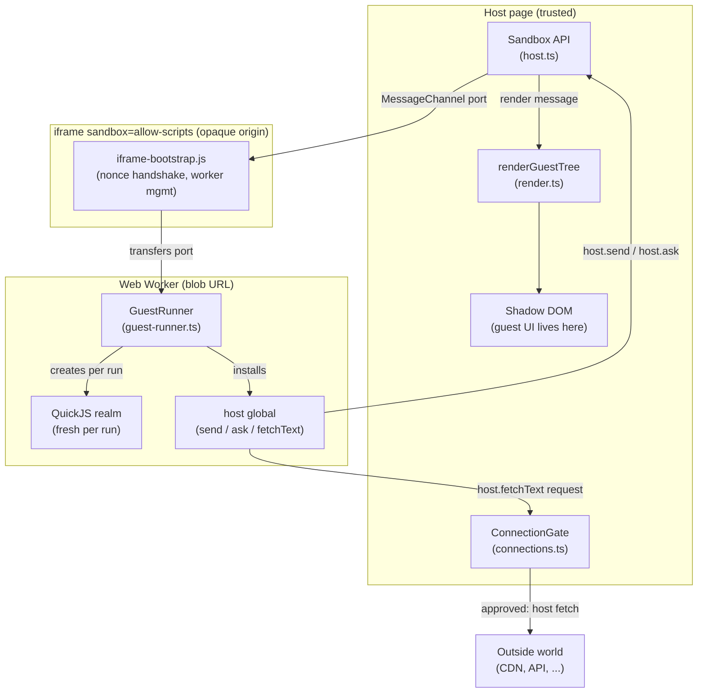
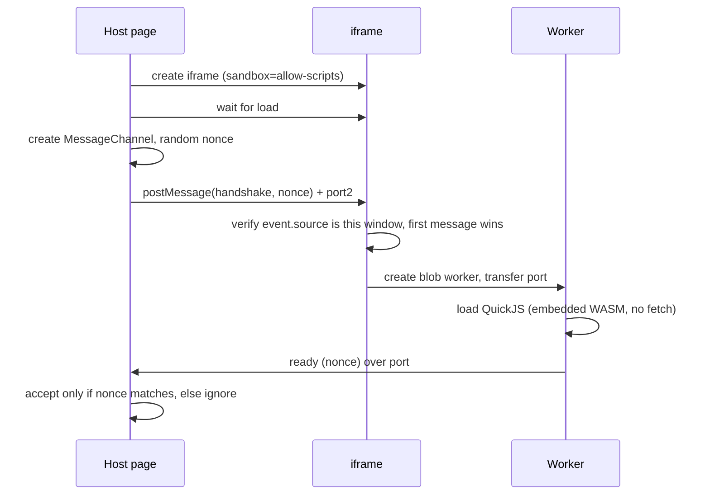
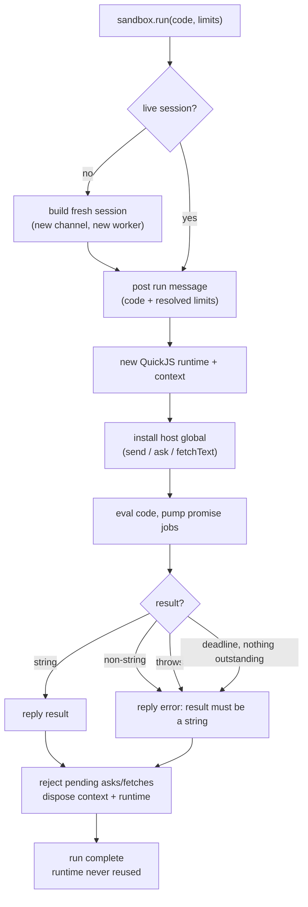
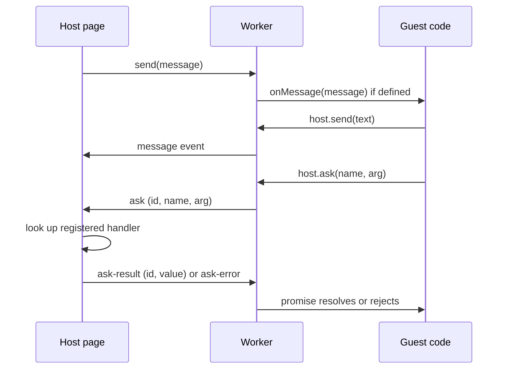
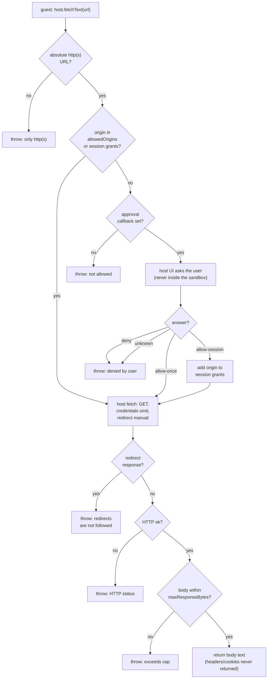
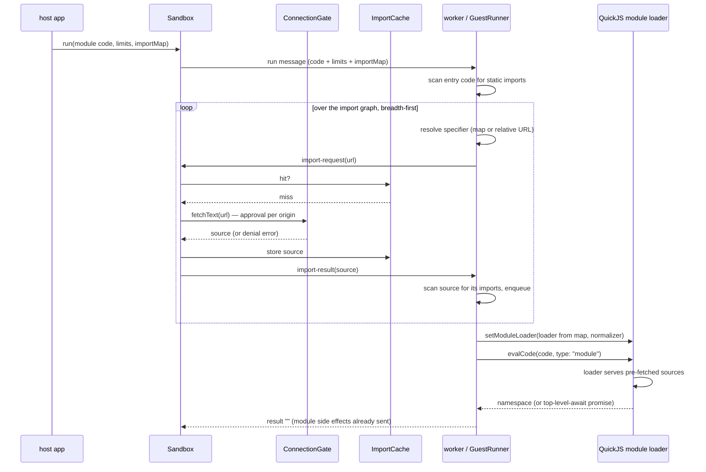
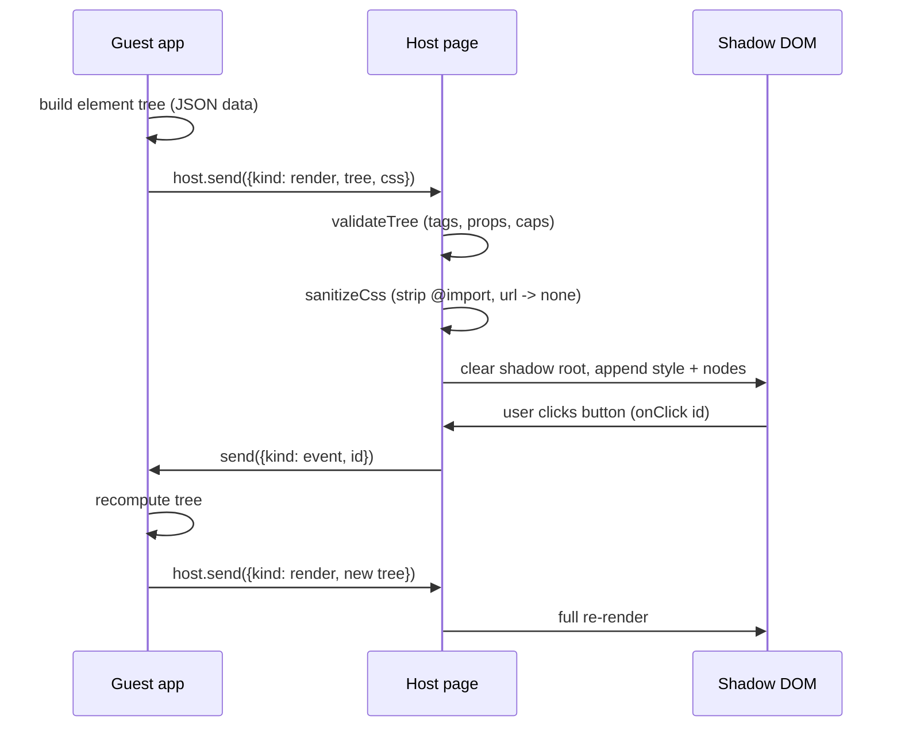
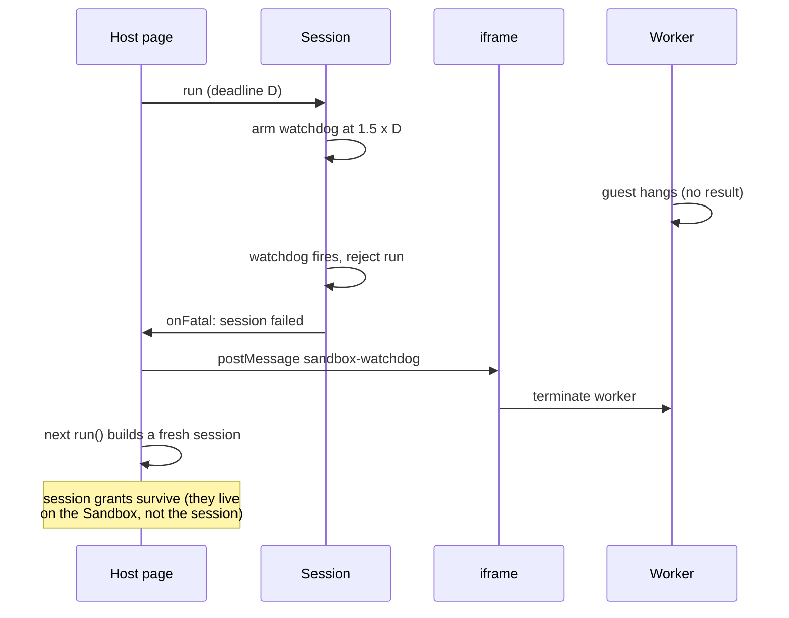
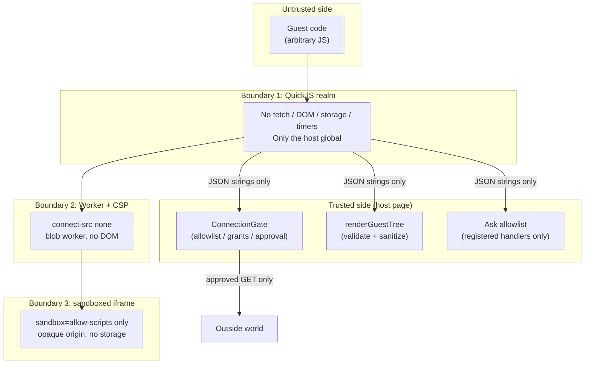

# icecream-sandbox: design

How the library works, flow by flow. Each section has a diagram and the
reasoning behind it. If a diagram and the code ever disagree, the code
wins — and the diagram is a bug to fix.

## Principles

1. **Layers, not checks.** Isolation comes from three nested layers
   (iframe, worker, QuickJS realm), each of which independently blocks
   whole classes of access. No single check is load-bearing.
2. **The guest asks; the host acts.** The guest has no capability of
   its own — no network, no DOM, no storage. Everything it wants from
   the outside world is a request the host may refuse.
3. **Data crosses boundaries, never objects.** Every message is a JSON
   string. There are no handles, no functions, no shared objects to
   smuggle capabilities through.
4. **Fail closed.** Malformed input is ignored, unknown approval
   answers deny, missing callbacks deny, oversized bodies reject.
   Nothing defaults to "allow".
5. **Fresh state per run.** A run gets a new QuickJS runtime and
   context, disposed when the run settles. Nothing survives a run —
   especially not corruption from an out-of-memory error.

## System overview

The host page owns the `Sandbox` object, the connection gate, and the
renderer. The iframe is a thin, unprivileged shell: it verifies the
handshake nonce, starts the worker from a Blob URL, and terminates the
worker on watchdog orders. It runs no guest code and holds no state.
The worker runs the guest inside QuickJS. The guest's only bridge out
is the `host` global, and every call on it is a JSON message over the
port back to the host page.

## Handshake

The iframe's origin is `"null"` (opaque), so origin checks are useless
here. Trust is established with a random nonce plus `event.source`
checks, not with origins.

Notes:

- The iframe trusts the **first** handshake message's `event.source`
  and ignores all later sources. A page that can post to the iframe
  from another window cannot hijack the port without the nonce.
- The worker is created from a Blob URL so no network fetch is needed
  to start it — and the iframe's CSP (`connect-src 'none'`) would
  block one anyway.
- `Sandbox.create()` resolves only after the worker's `ready`
  message arrives with the right nonce, or the handshake times out.

## Run lifecycle

Key details:

- Limits are resolved host-side (`resolveLimits`) and travel with the
  run message, so the worker enforces the same limits the host
  promised — including the 256 KiB stack ceiling, above which values
  are rejected outright (larger stacks crashed the host in testing).
- The pump loop runs QuickJS promise jobs and yields so port messages
  (ask replies, host sends) can arrive. The QuickJS interrupt handler
  caps CPU inside each eval/jobs burst; the deadline caps wall-clock
  waiting when a guest promise never settles and nothing is
  outstanding.
- Teardown order matters (found by testing, not by reasoning): pending
  deferreds are rejected first, the pump loop's `finally` disposes the
  completion handle, and only then is the runtime freed. Freeing the
  runtime while the completion handle is alive trips a QuickJS
  assertion (`gc object list not empty`).
- A run's runtime is never reused — least of all after an
  out-of-memory error, where the heap may be corrupt.
- Module runs insert one step between installing the host global and
  evaluating: the worker pre-fetches the static import graph (see
  [Module imports](#module-imports)) and only then evaluates with
  `type: "module"`. Classic scripts skip that step entirely and
  behave exactly as before.

## Messaging and asks

Rules:

- Host-to-guest messages only land while a run is in flight. A
  long-lived guest app keeps its run open with a promise that settles
  when the app ends (see the demo's counter app).
- Ask names are an explicit allowlist. An unregistered name, a
  non-string argument, or a handler returning a non-string all reject
  inside the guest.
- Asks and fetches share the same deferred-promise machinery in the
  runner, with separate caps (`maxOutstandingAsks` 8,
  `maxOutstandingFetches` 4) and separate pending maps, so a stuck
  fetch cannot starve asks or vice versa.

## Connection gate

The guest's only network path. Everything else on this page is
unprivileged plumbing; this is the decision point.

Why redirects are rejected, not followed: in browsers, a fetch with
manual redirect handling returns an opaque-redirect response — status
0, empty headers. The destination is invisible, so a gate cannot
re-check it. Following redirects blindly would let an approved origin
bounce the request to an unapproved one. Requesting the final URL
directly (https, versioned CDN path) is the safe form, and it behaves
identically in Node and in browsers. This was found by a failing
browser test, not predicted in advance — see
`docs/threats-and-tests.md`.

Why the approval UI must live in the host page: anything rendered
inside the sandbox (or anywhere the guest can influence) can be
spoofed by the guest into a fake "yes". The callback runs in trusted
host UI by construction — the library never renders it.

Why credentials are omitted: the host fetch must never ride the host
page's login. A guest that could trigger authenticated requests would
turn the gate into a confused deputy.

## Module imports

Key details:

- The split is forced by QuickJS, not chosen: the module loader is
  synchronous and cannot await a fetch, so all async work (gate
  approval, download) happens before evaluation, over the port, where
  async is natural. The loader then serves only what prefetch already
  downloaded — it can never trigger a download the gate did not
  approve.
- The normalizer canonicalizes every specifier the loader will ever
  see: bare names through the import map, relatives through URL
  resolution against the importing module's URL. An unmapped bare
  name, a relative import in entry code (which has no URL), or a
  non-http(s) result fails the run with the specifier named.
- The cache lives on the Sandbox, next to the grants, for the same
  reason: a watchdog rebuild must neither re-download nor re-prompt
  for a module already imported. Grants and cache both die on
  `dispose()`.
- A module run's result is `""` when the module finishes
  synchronously — its namespace is not a result. A top-level await
  that never settles keeps the run alive for events, exactly like a
  classic long-lived app; the run deadline still bounds it.
- Bounds: `maxImportModules` (graph size), `maxImportDepth` (chain
  depth), the run deadline (which covers fetching too), the gate's
  response cap, and the port's `maxInboundBytes` (a module source
  must fit both to cross).

## Guest UI rendering

The guest cannot touch the DOM. It can still render, because rendering
is split in two: the guest describes, the host builds.

Rules enforced by `render.ts`:

- No `innerHTML` anywhere. Text children become text nodes, so a
  guest string can never become markup — even `""`
  renders as visible text.
- A tag allowlist. No `script`, `iframe`, `object`, `embed`, `link`,
  `meta`, `base`, `form`, or `style` elements from the guest. Styles
  arrive only through the `cssText` argument, after sanitization.
- No remote media. An `` `src` must be a `data:` URL. A remote
  `src` would make the host page fetch a guest-chosen URL with no
  gate approval — an exfiltration channel
  (``). Remote images belong
  behind `host.fetchText`; binary fetch is a follow-up (v1 returns
  text).
- Links: `href` must be `http(s)`; `javascript:` is dropped, and
  `_blank` links get `rel="noopener"`. A link with an `onClick` id does
  not navigate on click — the click is preventDefaulted and reported
  as an event, so the host decides (a gated link). A link with no event
  id navigates normally.
- Events are string ids, never functions. The host maps an id to a
  listener; the guest learns only that its id fired.
- Trees are capped (depth 32, 5000 nodes) before any DOM is built, so
  a hostile tree cannot exhaust the host page.
- The shadow root scopes guest CSS: guest styles cannot leak into the
  host page, and host styles cannot leak into the guest app.

JSX note: guest components may be authored as JSX and compiled by the
app's own toolchain into createElement-style calls before `run()`.
The library ships no JSX compiler — that keeps the worker bundle
small and keeps compilation (a trust decision about what code runs)
on the host side, where it belongs.

## Watchdog and session rebuild

Design points:

- The watchdog multiplier (1.5×) is fixed by design, not a knob: it
  must exceed the deadline (so a run that is merely slow at the
  boundary is not killed early) without letting a hung worker linger.
- The session is marked failed and never reused. The iframe
  terminates the worker immediately; the replacement session is built
  lazily on the next `run()`, so a transient failure costs one round
  trip, not a permanently dead sandbox.
- Session grants live on the `Sandbox`, not on a `Session`, so a
  watchdog rebuild does not re-prompt the user for an origin they
  already approved. Grants die only on `dispose()` or revocation.
- The run deadline does not kill outstanding asks or fetches early:
  those are bounded by their own timeouts (ask handlers, connection
  timeout) plus the session watchdog.

## Threat boundaries

Each boundary blocks whole classes independently: even if the guest
somehow obtained a real `fetch` (it cannot — nothing puts one in the
realm), the worker CSP would block the request; even if the CSP were
bypassed, the iframe has no network-useful origin or storage; even if
all three failed, the only sanctioned network path is the gate, which
still requires approval. The threats-and-tests doc
(`docs/threats-and-tests.md`) maps each threat to the boundaries that
stop it and the tests that prove it.

## Module map

| Module | Owns |
| --- | --- |
| `src/host.ts` | `Sandbox`: iframe creation, handshake, session lifecycle, grant storage, public API. |
| `src/session.ts` | `Session`: one port, one in-flight run, ask routing, connection routing, watchdog. |
| `src/worker.ts` | Thin worker adapter: port plumbing into `GuestRunner`. |
| `src/guest-runner.ts` | `GuestRunner`: the only code that touches QuickJS. Runs, `host` global, pump loop, teardown order. |
| `src/iframe-bootstrap.js` | Iframe side: nonce handshake, blob worker creation, watchdog termination. |
| `src/protocol.ts` | Wire protocol: message types, encode/decode with shape validation. |
| `src/limits.ts` | Run limits, defaults, and validation (including the 256 KiB stack ceiling). |
| `src/connections.ts` | `ConnectionGate`: allowlist, session grants, approval, host fetch. |
| `src/render.ts` | `validateTree`, `sanitizeCss`, `renderGuestTree`: guest UI on the host. |
| `src/index.ts` | Public exports. |

## Invariants (do not break these)

- The iframe sandbox attribute is `allow-scripts` only. Adding
  `allow-same-origin` would let the guest document reach the host
  origin's storage and cookies. There is no fallback that weakens this;
  if a browser cannot run blob workers in opaque iframes, serve the
  iframe document from a dedicated cross-site origin instead.
- The worker bundle never contains host-side code (gate, renderer).
  Rendering and fetching happen on the host, never in the worker.
- A guest result must be a string. Anything else rejects — the wire
  format has no other shape.
- A failed session is never reused. A disposed runtime is never
  reused. A run's output is capped even when every individual message
  is under its cap (`maxTotalOutputBytes`).
- The gate never follows redirects, never sends credentials, and
  never returns headers. These are not options; they are the design.
